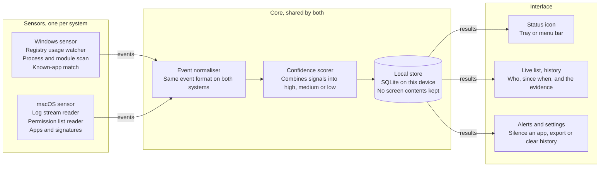
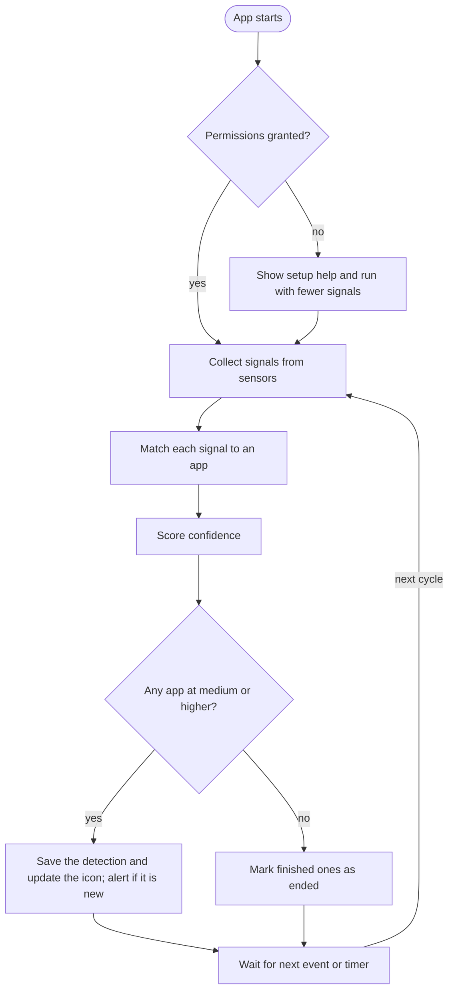

# ARCHITECTURE.md — Screen-Use Detector

*Last updated: Stage 0, 2026-10-11*

---

## 1. Component overview

Three layers: **sensors** (one small program per OS) → **core** (shared logic) → **interface**. The interface only reads results.



### Component responsibilities

| Component | Language | Responsibility | Runs as |
|-----------|----------|---------------|---------|
| Windows sensor | Rust (`windows` crate) or C# | Read ConsentStore registry, scan processes/modules, match known apps | Sidecar process, stdout JSON-lines |
| macOS sensor | Swift | Stream unified log, read TCC list, enumerate running apps + signatures | Sidecar process, stdout JSON-lines |
| Core | Rust | Normalise events, score confidence, manage detection state machine, SQLite storage, known-app config | Library linked into Tauri backend |
| Interface | TypeScript + React (Tauri 2 shell) | Tray/menu-bar icon, main window, alerts, settings | Tauri app process |

---

## 2. Detection-loop flowchart



The loop runs on events plus a fallback timer. A missing permission reduces available signals but never stops the app. A detection is marked ended only when a full cycle no longer sees it, after a grace period.

---

## 3. Folder map

```text
screen-use-detector/
├── core/                  Rust: scoring, event model, SQLite storage, config
├── sensors/
│   ├── windows/           Rust/C#: registry watcher, process/module scan
│   └── macos/             Swift: log stream, TCC reader, app signatures
├── app/                   Tauri 2 shell + React interface
├── spike/                 Throwaway Python experiments (Stage 1)
├── lab/                   Test scenarios, manual test steps
├── scripts/               check-docs, helper scripts
├── docs/
│   ├── design-reference.md   Sections 1-7 of the brief (verbatim)
│   ├── references.md         External links and research
│   ├── signal-findings.md    Test matrix results
│   └── decisions/            Individual decision records
├── CONTEXT.md             Why and where we are
├── FEATURES.md            What exists
├── ARCHITECTURE.md        How it is built (this file)
└── README.md              Install and usage
```

---

## 4. Event schema (version 1)

Sensors emit newline-delimited JSON events to stdout. The core reads them via a pipe. This is a versioned contract — changes require a version bump and a logged decision.

```json
{
  "v": 1,
  "ts": "2026-10-11T14:30:00Z",
  "os": "windows",
  "sensor": "consent_store",
  "signal": "usage_record_active",
  "class": "reliable",
  "app": {
    "name": "obs64.exe",
    "pid": 1234,
    "path": "C:\\Program Files\\obs-studio\\bin\\64bit\\obs64.exe",
    "publisher": "OBS Project",
    "signed": true
  },
  "method_hint": "graphics_capture",
  "ended": false,
  "session_id": "consent_store:obs64.exe:1234",
  "detail": {}
}
```

### Field reference

| Field | Type | Required | Description |
|-------|------|----------|-------------|
| `v` | integer | yes | Schema version, currently `1` |
| `ts` | string (ISO 8601) | yes | UTC timestamp of the observation |
| `os` | string | yes | `"windows"` or `"macos"` |
| `sensor` | string | yes | Sensor identifier (e.g. `"consent_store"`, `"unified_log"`, `"process_scan"`, `"tcc_list"`, `"running_apps"`) |
| `signal` | string | yes | Specific signal name (e.g. `"usage_record_active"`, `"usage_record_ended"`, `"log_recording_started"`, `"capture_module_loaded"`, `"known_app_running"`, `"tcc_permission_granted"`) |
| `class` | string | yes | `"reliable"` or `"corroborating"` — sensor's own assessment of signal strength |
| `app` | object | yes | Information about the detected app |
| `app.name` | string | yes | Process or app name |
| `app.pid` | integer | no | Process ID (0 or absent if not applicable) |
| `app.path` | string | no | Full path to the executable |
| `app.publisher` | string | no | Code-signing publisher name |
| `app.signed` | boolean | no | Whether the app is code-signed |
| `method_hint` | string | no | Best guess at capture method (e.g. `"graphics_capture"`, `"screen_recording"`, `"screenshot"`, `"meeting_share"`, `"unknown"`) |
| `ended` | boolean | no | `true` if this event signals the END of a capture session; default `false` |
| `session_id` | string | no | Stable identifier for a capture session, used to correlate start/end events |
| `detail` | object | no | Free-form per-sensor data (registry values, log lines, module names, etc.) |

### Known sensor identifiers

| Sensor ID | OS | Signals emitted |
|-----------|----|-----------------|
| `consent_store` | Windows | `usage_record_active`, `usage_record_ended` |
| `process_scan` | Windows | `capture_module_loaded`, `known_app_running` |
| `tcc_list` | macOS | `tcc_permission_granted` |
| `unified_log` | macOS | `log_recording_started`, `log_capture_denied`, `log_recording_ended` |
| `running_apps` | macOS | `known_app_running` |

---

## 5. Signal catalogue

### Windows signals

| Signal | Sensor | Class | What it detects | How |
|--------|--------|-------|-----------------|-----|
| `usage_record_active` | `consent_store` | reliable | App actively using a capture capability | Registry `LastUsedTimeStop == 0` |
| `usage_record_ended` | `consent_store` | reliable | App stopped using a capture capability | Registry `LastUsedTimeStop > 0` |
| `capture_module_loaded` | `process_scan` | corroborating | Process loaded a capture-related DLL | `EnumProcessModules` check for `Windows.Graphics.Capture.dll` etc. |
| `known_app_running` | `process_scan` | corroborating | A known recorder/meeting app is running | Process name + code-signing publisher match |

### macOS signals

| Signal | Sensor | Class | What it detects | How |
|--------|--------|-------|-----------------|-----|
| `tcc_permission_granted` | `tcc_list` | reliable | App has Screen Recording permission | Read `kTCCServiceScreenCapture` from TCC database (needs Full Disk Access) |
| `log_recording_started` | `unified_log` | reliable | A recording or capture session started | Unified log predicate on `com.apple.TCC`, `screencapture`, `screencaptureui` |
| `log_recording_ended` | `unified_log` | reliable | A recording session ended | Unified log events indicating stop |
| `log_capture_denied` | `unified_log` | reliable | A capture permission was denied | TCC denial log entry |
| `known_app_running` | `running_apps` | corroborating | A known recorder/meeting app is open | `NSWorkspace.runningApplications` + code signature |

---

## 6. Scoring rules

The core scores confidence for each app based on accumulated signals. Only the core assigns confidence — sensors never decide confidence.

| Level | Rule | Example |
|-------|------|---------|
| **High** | ≥ 2 independent signals agree for the same app, at least one `reliable` | Usage record active + known recorder running |
| **Medium** | Exactly 1 `reliable` signal | Usage record active, no corroboration |
| **Low** | Only `corroborating` signals | Capture module loaded, not a known app |

### Additional rules
- Signals must agree on the same app (matched by normalized app name or PID).
- A detection **starts** when confidence reaches low or above.
- A detection **ends** only when a full detection cycle no longer produces any signal for the app, after a grace period (default: 5 seconds) to avoid flicker.
- Confidence can change during a detection (e.g., low → high as more signals arrive).

> **Decision [2026-10-11]:** Grace period set to 5 seconds initially. Will tune based on Stage 1 findings about signal timing and latency.

---

## 7. Detection state machine

```text
                    ┌─────────────┐
     signal seen    │             │   no signal for
    ┌──────────────►│   ACTIVE    │───grace period──►┌─────────┐
    │               │             │                  │  ENDED  │
    │               └──────┬──────┘                  └─────────┘
    │                      │
    │               signal still seen
    │                      │
    │               ┌──────▼──────┐
    │               │   ACTIVE    │ (confidence may change)
    │               │  (updated)  │
    │               └─────────────┘
    │
┌───┴──────┐
│ INACTIVE │  (no prior detection for this app)
└──────────┘
```

States:
- **INACTIVE**: No detection exists for this app.
- **ACTIVE**: One or more signals seen. Has a confidence level (high/medium/low), evidence list, and `started_at`. Updated each cycle. Written to DB.
- **GRACE**: No signal seen this cycle, but grace period hasn't elapsed. Not yet ended.
- **ENDED**: Grace period elapsed with no signals. `ended_at` written to DB.

---

## 8. Data model

```sql
CREATE TABLE detections (
  id          INTEGER PRIMARY KEY,
  os          TEXT NOT NULL,      -- 'windows' or 'macos'
  app_name    TEXT NOT NULL,
  publisher   TEXT,               -- code-signing publisher
  method      TEXT,               -- best guess at the capture method
  confidence  TEXT NOT NULL,      -- 'high', 'medium', 'low'
  started_at  TEXT NOT NULL,      -- ISO 8601 UTC
  ended_at    TEXT,               -- ISO 8601 UTC; NULL while still active
  evidence    TEXT                -- JSON array of signal records
);

CREATE TABLE silenced_apps (
  id          INTEGER PRIMARY KEY,
  app_name    TEXT NOT NULL,
  publisher   TEXT,
  silenced_at TEXT NOT NULL       -- ISO 8601 UTC
);

CREATE TABLE settings (
  key         TEXT PRIMARY KEY,
  value       TEXT NOT NULL
);
```

> `silenced_apps` and `settings` tables added to support the silence list and configurable alert threshold (Stage 6).

---

## 9. Sidecar / IPC protocol

- Each sensor runs as a child process of the Tauri app.
- Communication: sensor writes newline-delimited JSON (one event per line, schema v1) to **stdout**. The core reads the sensor's stdout pipe.
- Sensor lifecycle: the Tauri backend spawns the sensor, monitors its stdout, and restarts it if it exits unexpectedly.
- Sensors write diagnostic messages to **stderr** (not parsed by the core, but logged).
- No other IPC mechanism in v1 (no sockets, no shared memory).

---

## 10. Interface structure

Based on the wireframe in section 5 of the design reference.

### Main window
- **Title bar**: "Screen-Use Detector"
- **Status banner**: count of active detections + last update time. Shows "No screen capture detected" (never "safe") when idle. Shows degraded-mode warning when permissions are missing.
- **Tabs**: Live | History | Settings
- **Live tab**: split pane
  - Left: detection list table (App, Method, Since, Level)
  - Right: evidence panel for selected row (publisher, signals fired, level explanation, [Silence] and [Copy report] buttons)
- **History tab**: past detections from the database
- **Settings tab**: alert threshold, silence list management, export, delete history
- **Footer**: "Stored on this device only"

### Tray / menu-bar popover
- Summary line: "Screen capture: N active" or "No screen capture detected"
- List of active detections (app name + confidence)
- Actions: "Open window", "Pause alerts"

### Alert notification
- Fires for NEW detections at medium or higher confidence
- Shows app name and "started capturing your screen"
- Clicking opens the main window with the evidence panel

---

## 11. Privacy design

Hard rules enforced in code and CI:
1. **No network access, no telemetry.** CI check fails if a network crate is added.
2. **No screenshots or screen contents** ever stored.
3. **No window titles** in version 1.
4. UI says "not detected", never "safe".
5. User can delete history and export it.
6. Local SQLite storage only — no cloud, no sync.
7. Tool does not hide from detection, record keystrokes, or monitor other people.

---

## 12. Build and release

| Phase | Target | Stage |
|-------|--------|-------|
| Spike | Python prototypes for signal discovery | 1 |
| Core + sensors | Rust workspace + OS-specific sensors | 2–4 |
| Interface | Tauri 2 + React app | 5–6 |
| Release | Installers, signing, notarization | 7 |

### Build requirements
- **Rust** (stable): core and possibly Windows sensor
- **Swift**: macOS sensor
- **Node.js + npm**: Tauri frontend
- **Tauri CLI**: `cargo install tauri-cli`
- **Python 3**: spike scripts (Stage 1), check-docs script

---

## 13. Links to decisions

See `CONTEXT.md` section 3 (Decisions log) and `docs/decisions/` for detailed records.
