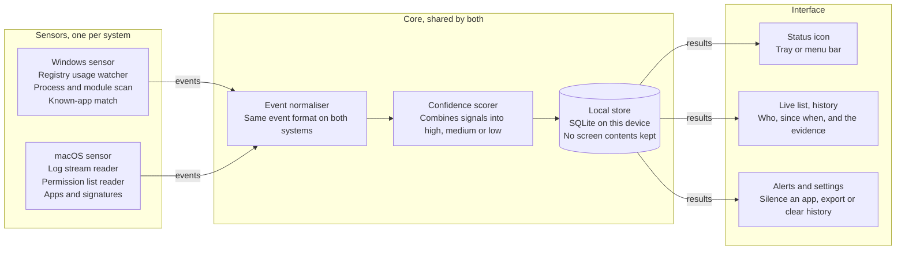
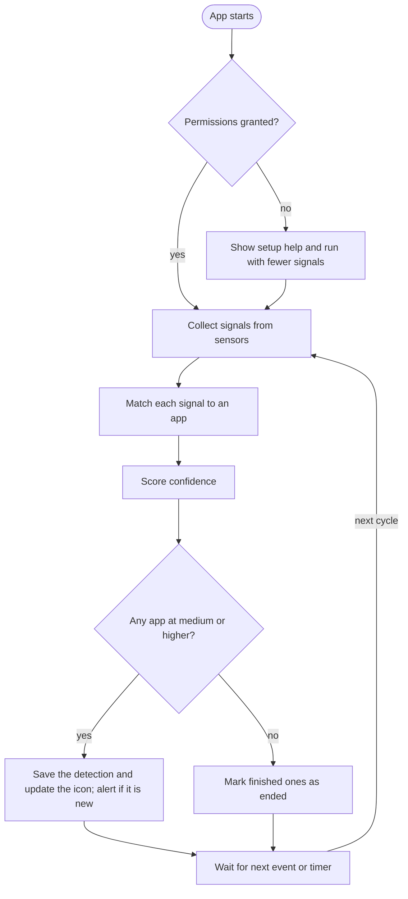

# Design Reference

*Saved verbatim from the original brief, sections 1 to 7.*

## 1. What the product does

The app runs in the background on a computer I own and tells me, in near real time, which apps are **capturing, recording or sharing the screen**. Every app draws to the screen, so "using the screen" does NOT mean that; it means capture.

| Level | Example | Version 1? |
| --- | --- | --- |
| Screenshot | A snipping tool, or a script that grabs one frame | Yes |
| Recording or sharing | OBS, a Zoom or Teams screen share, a browser screen share | Yes |
| Remote viewing | Remote desktop, AirPlay mirroring | Later |

Each detection shows the app name, its publisher, a guess at the capture method, when it started, and a confidence level (high, medium or low) with the evidence behind it.

### What the operating systems let you detect
Neither Windows nor macOS offers one public call that answers "who is capturing my screen right now?" (developers have asked Apple exactly this for apps like Zoom and browsers sharing during a call). So the design **combines several weaker signals and scores them** instead of trusting one source. Three kinds of signal exist on both systems:

- **Permission or usage records.** Windows keeps per-app usage timestamps in a registry store; macOS keeps a list of apps allowed to record. Cheap and reliable, but they can lag or under-report.
- **System logs and events.** macOS logs screen-capture permission decisions and the start of recordings; Windows can emit tracing events for graphics activity. Closer to real time, but need more privileges.
- **Process evidence.** Which apps are running, who signed them, which capture libraries they loaded. The noisiest signal, so it only raises or lowers confidence.

Expect gaps. On macOS, apps that use Apple's system picker may not appear in the permission list at all; on Windows an app can capture without any record you can read cheaply. The confidence level is how the tool stays honest about this. The UI must say "not detected", never "safe".

## 2. Operating system details

Target **Windows 10 (2004 or later) and Windows 11**, and **macOS 13 or later on Apple silicon and Intel**. These baselines are a recommendation: modern capture tools use the newer capture APIs on both systems.

**Treat every row below as a hypothesis to verify in Stage 1 on real machines, not as fact.**

### Windows signals

| Signal | What it tells you | How to read it | Caveat |
| --- | --- | --- | --- |
| Capability usage store | Which apps used a protected capability, with start and stop times | Registry under `HKCU\Software\Microsoft\Windows\CurrentVersion\CapabilityAccessManager\ConsentStore\<capability>\NonPackaged\<path, with # in place of \>`, values `LastUsedTimeStart` and `LastUsedTimeStop`; a stop time of 0 means in use now. Final version watches with `RegNotifyChangeKeyValue` instead of polling. | Known to work in practice for webcam and microphone. Screen-capture capabilities (`graphicsCaptureProgrammatic`, `graphicsCaptureWithoutBorder`) exist, but TEST whether they record per-app timestamps. |
| Windows Graphics Capture | The modern capture API (Windows 10 version 1803 and later); apps normally trigger a yellow border around the captured window or screen | Not directly listable. Use the visible border as ground truth when testing by hand. | Apps can ask the user for borderless capture, so the border is not a guarantee. |
| Loaded modules | Which processes loaded capture-related libraries | `EnumProcessModules` per process; look for `Windows.Graphics.Capture.dll` and duplication-related graphics libraries | Low confidence alone; many apps load graphics libraries without capturing. Needs elevation for other users' processes. |
| Known-app list | Whether a known recorder or meeting app is running | Match process name PLUS code-signing publisher, never the name alone | Only finds apps you listed. Good for raising confidence. |
| Event tracing (ETW) | Graphics and window-manager activity | Subscribe to graphics and desktop-compositor providers | Needs administrator rights and heavy testing. Optional late experiment only. |

A normal user account is enough for the registry and process checks. Run as a tray app first; a Windows service only matters if detection is needed before sign-in.

### macOS signals

| Signal | What it tells you | How to read it | Caveat |
| --- | --- | --- | --- |
| Screen Recording permission list | Which apps are allowed to record | Service `kTCCServiceScreenCapture` in the privacy database; reading it needs Full Disk Access for the app | Shows who MAY record, not who is recording. Apps using Apple's system picker may not need the broad permission. |
| Unified log | Permission decisions and recording starts | Stream the log with a predicate on subsystem `com.apple.TCC`; also watch processes `screencapture` and `screencaptureui`, which log a recording-setup message when a recording starts | Log formats change between macOS releases; some entries may need admin rights. Re-test on every supported version. |
| Running apps and signatures | Whether a known recorder or meeting app is open | `NSWorkspace.runningApplications` plus the code signature of each app | Raises or lowers confidence only. |
| Window and display lists | What is on screen, not who captures it | ScreenCaptureKit (`SCShareableContent`) | Fields that depend on the Screen Recording permission have changed between releases, so do NOT build detection on them. |
| Own permission state | Whether your own app may record | `CGPreflightScreenCaptureAccess()` | Only about your own app. |

Ship the Mac app as a signed, notarized app with the hardened runtime on. Onboarding guides the user to grant Full Disk Access once, and the app must keep working in a reduced mode without it.

## 3. System design

Three layers: **sensors** (one small program per OS) -> **core** (shared logic) -> **interface**. The interface only reads results.



**Components**
- **Sensors** are separate sidecar processes. Each is its own small program for one OS, contains no scoring logic, and writes newline-delimited JSON events to stdout.
- **Core** (Rust): event normaliser, confidence scorer, detection state machine, SQLite store, known-app config. Only the core decides how confident a detection is, so a result means the same thing on Windows and on macOS.
- **Interface**: Tauri 2 + React + TypeScript (tray or menu-bar icon, main window, alerts).

**Event shape** (refine in Stage 0, then treat as a versioned contract):
```json
{ "v": 1, "ts": "2026-10-11T14:30:00Z", "os": "windows", "sensor": "consent_store",
  "signal": "usage_record_active", "class": "reliable",
  "app": { "name": "obs64.exe", "pid": 1234, "path": "C:\\...", "publisher": "OBS Project", "signed": true },
  "method_hint": "graphics_capture", "detail": {} }
```

**Scoring rule to start with** (tune from Stage 1 findings; record every change as a decision)
- `reliable` signal: an OS usage record shows the app active, or a log entry shows a recording started.
- `corroborating` signal: a known recorder or meeting app is running, or a capture-related module is loaded.
- **High**: two independent signals agree for the same app, at least one `reliable` (example: usage record plus a known recorder running).
- **Medium**: one `reliable` signal on its own.
- **Low**: `corroborating` evidence only (example: a loaded capture library).
- A detection ends only when a full cycle no longer sees it; use a short grace period to avoid flicker.

**Data model** (one table covers version 1; the interface reads from it)
```sql
CREATE TABLE detections (
  id          INTEGER PRIMARY KEY,
  os          TEXT NOT NULL,      -- 'windows' or 'macos'
  app_name    TEXT NOT NULL,
  publisher   TEXT,               -- code-signing publisher
  method      TEXT,               -- best guess at the capture method
  confidence  TEXT NOT NULL,      -- 'high', 'medium', 'low'
  started_at  TEXT NOT NULL,
  ended_at    TEXT,               -- empty while still active
  evidence    TEXT                -- JSON list of signals that fired
);
```

## 4. Flowchart: the detection loop



The loop runs on events plus a timer. A missing permission reduces the signals available but never stops the app. A detection is marked ended only when a cycle no longer sees it.

## 5. Wireframe

The same three surfaces work on both systems: a main window with a status banner and live list, a small popover from the tray or menu bar, and an alert when a new app starts capturing. Selecting a row fills the evidence panel, so every claim the tool makes can be checked. (All names and times below are sample data; the highlighted row, marked `>`, is the selected one.)

**Main window**
```text
+------------------------------------------------------------------------+
| Screen-Use Detector                                             o o o  |
+------------------------------------------------------------------------+
| +--------------------------------------------------------------------+ |
| | 2 apps are capturing your screen                  Updated just now | |
| +--------------------------------------------------------------------+ |
|  Live    History    Settings                                           |
|  ====                                                                  |
| +---------------------------------------+ +--------------------------+ |
| | App         Method        Since Level | | Evidence for OBS Studio  | |
| |---------------------------------------| | Publisher: OBS Project   | |
| |>OBS Studio  Recorder      19:42 High  | | Signals that fired:      | |
| | Zoom        Meeting share 19:30 High  | | * Usage record shows it  | |
| | Unknown app Frame grabbing 19:51 Low  | |   active                 | |
| |                                       | | * Known recorder is      | |
| |                                       | |   running                | |
| |                                       | | High: two signals agree  | |
| |                                       | | [Silence][Copy report]   | |
| +---------------------------------------+ +--------------------------+ |
|  Stored on this device only                                            |
+------------------------------------------------------------------------+
```

**Tray or menu-bar popover** and **alert notification**
```text
+--------------------------------+   +------------------------------------------+
| Screen capture: 2 active       |   | Zoom started capturing your screen       |
| OBS Studio . High              |   | Medium or higher results only.           |
| Zoom . High                    |   | Click to see evidence.                   |
|--------------------------------|   +------------------------------------------+
| Open window      Pause alerts  |
+--------------------------------+
```

**Behaviour to implement**
- The banner shows the number of active detections, or "No screen capture detected" (never "safe"), plus the last update time.
- The live list shows App, Method, Since and Level. Selecting a row fills the evidence panel (publisher, the signals that fired, the level and why). "Silence app" mutes alerts for that app; "Copy report" copies the evidence as text.
- Tabs: Live (current detections), History (past detections from the database), Settings.
- A degraded-mode banner appears when signals are missing (for example "Running with fewer signals: grant Full Disk Access").
- Alerts fire only for NEW detections at medium or higher. Clicking an alert opens the evidence.
- Footer on the main window: "Stored on this device only".

## 6. Tech stack, project layout and build approach

Start with a throwaway Python prototype (`winreg` for the Windows registry, `psutil` for processes, a subprocess running the macOS `log stream` command) to learn which signals actually fire, then build the real app around what you saw.

Real app: a shared **core in Rust** (or Python if I ask to ship faster), a **Windows sensor** (Rust `windows` crate, or C#), a **macOS sensor** (a Swift helper that streams the log and reads running apps and signatures; use Rust only if it does the job cleanly), and a **Tauri + React** shell giving one codebase for tray and menu-bar apps. If a stack choice becomes a real blocker, stop and ask me; do not silently switch.

```text
screen-use-detector/
  core/              scoring, event model, SQLite storage
  sensors/
    windows/         registry watcher, process and module scan
    macos/           log stream reader, permission list, app signatures
  app/               Tauri shell and React interface
  spike/             throwaway Python experiments (Stage 1)
  lab/               scripted capture scenarios and manual test steps
  scripts/           check-docs and helper scripts
  docs/              design reference, signal findings per OS version, decisions
```

| Roadmap phase | Goal | Done when | Maps to stage |
| --- | --- | --- | --- |
| 1. Spike | Run each capture tool on each OS and record which signals fire | A table of signal against tool for Windows and macOS | Stage 1 |
| 2. Core and sensors | Event model, confidence scoring, local log, command-line output | The command line lists the right app for every test in the test matrix | Stages 2 to 4 |
| 3. Interface | Tray or menu-bar icon, live list, history view, alerts | A user can see and silence a detection without a terminal | Stages 5 and 6 |
| 4. Hardening | Permission onboarding, installers, signing and notarization, false-positive tuning, optional event-tracing experiment | Clean install works on a fresh Windows PC and a fresh Mac | Stage 7 |

## 7. Privacy, ethics and references

Hard rules (never violate):
- Runs on computers I own or administer only. Local storage only. **No network access, no telemetry.**
- Detections stay on the device in a local database. **Never store screenshots or screen contents.**
- Log app name, publisher, time and evidence. **No window titles in version 1.**
- The tool can miss captures; the UI says "not detected", never "safe".
- The user can delete history and export it as a file.
- Do not build anything that hides from detection, records keystrokes, or monitors other people. This is a defensive privacy tool. (Monitoring other people's devices can carry legal duties; I am not asking for that.)
